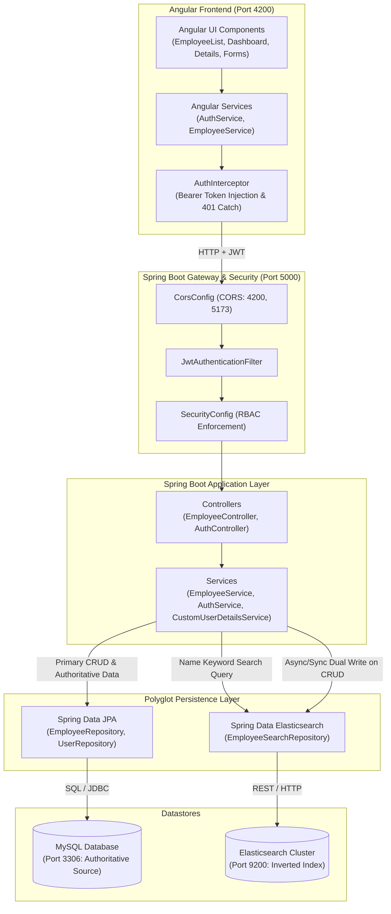
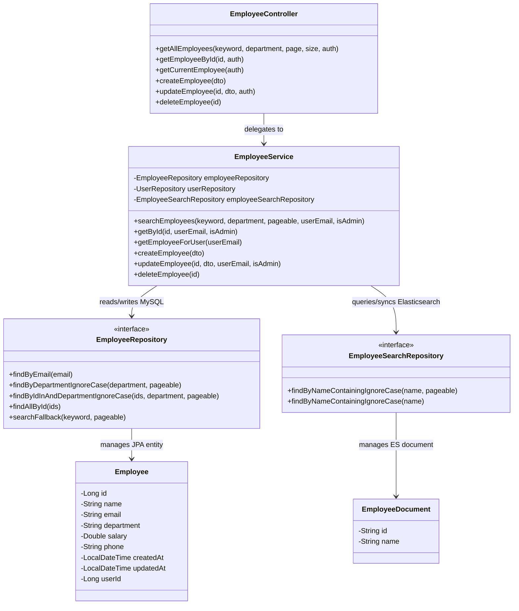
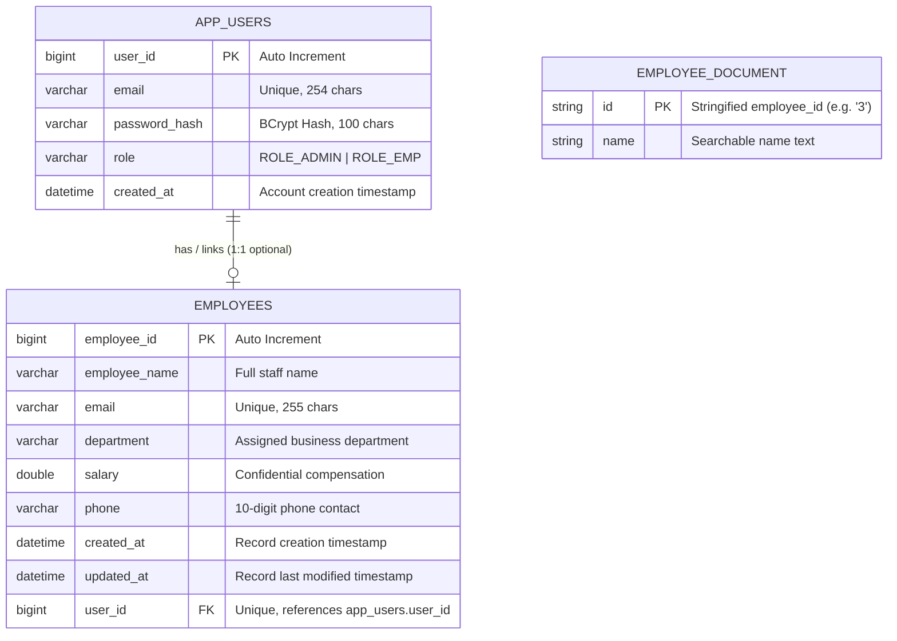
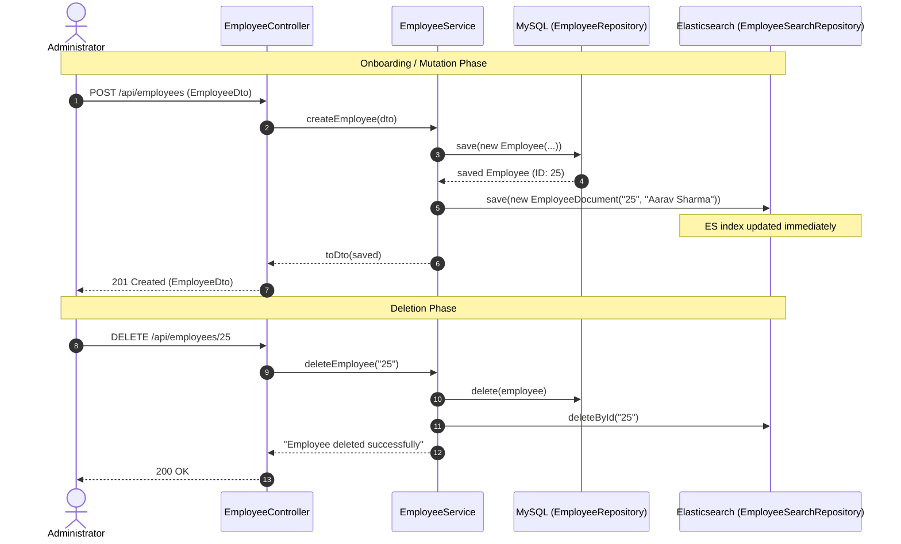
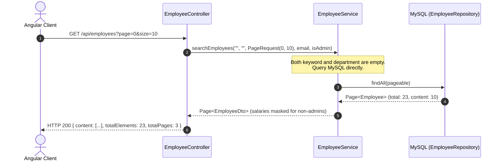
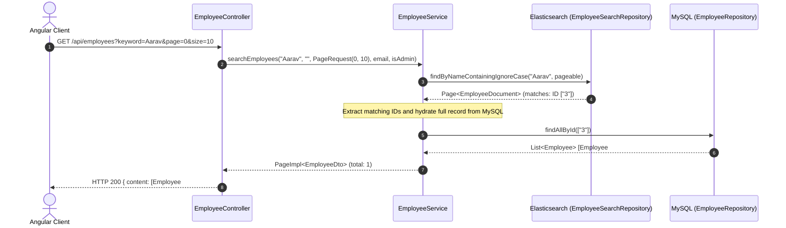
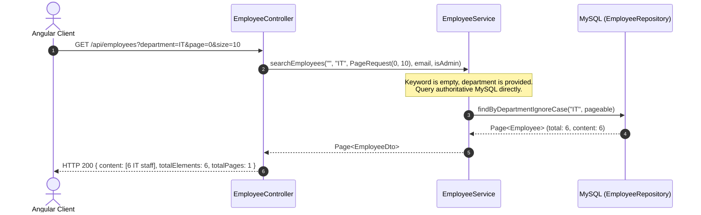
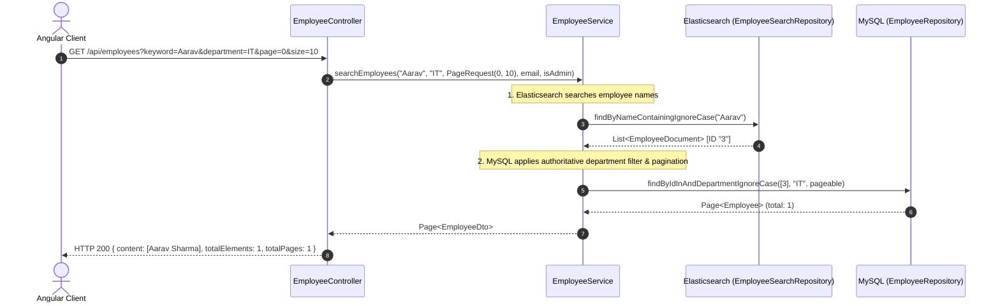
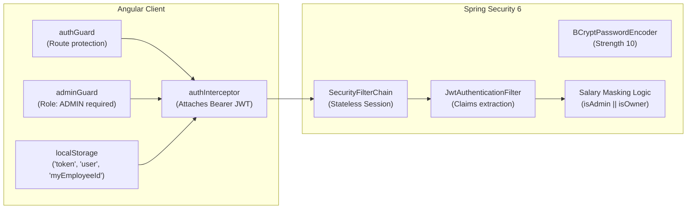

# Project Design & Architecture: Employee Management System

> **Document Version:** 1.0  
> **Application Architecture:** Polyglot Persistence (MySQL Authoritative Store + Elasticsearch Derived Search Index)  
> **Frontend:** Angular (Standalone Components, Signals, Reactive State)  
> **Backend:** Spring Boot (Spring Data JPA, Spring Data Elasticsearch, Spring Security, JWT)  

---

## 1. Project Overview

The **Employee Management System (EMS)** is an enterprise web application designed to manage corporate employee records, roles, departmental assignments, and compensation policies.

### Core Capabilities
1. **Role-Based Access Control (RBAC):**
   - **Administrators (`ROLE_ADMIN`):** Full CRUD privileges, salary visibility across all staff, employee onboarding, record updates, and profile deletions.
   - **Regular Employees (`ROLE_EMP`):** Self-service profile management, directory search, peer profile viewing (with confidential salary masking), and personal compensation verification.
2. **Polyglot Persistence Architecture:**
   - **MySQL:** Relational source of truth handling ACID transactions, employee lifecycle, account credentials, and departmental categorization.
   - **Elasticsearch:** Fast, distributed inverted-index search engine dedicated exclusively to keyword and employee-name discovery.
3. **Enterprise UI & Responsive Experience:**
   - Server-side debounced searching and paginated table navigation.
   - Departmental filtering and combined name + department filtering.
   - Stateless JWT authentication with seamless session recovery and HTTP interception.

---

## 2. High-Level Architecture Diagram



---

## 3. Backend Layer Design

The Spring Boot backend adopts a clean layered architecture with clear boundaries between HTTP routing, business logic, persistence abstractions, and domain entities.



### Layer Responsibilities

| Layer / Class | Class Name | Responsibility |
|---|---|---|
| **Controller** | `EmployeeController`<br>`AuthController` | Exposes REST endpoints, validates incoming DTOs (`@Valid`), extracts authentication context (`Authentication`), returns `ResponseEntity`. |
| **Service** | `EmployeeService`<br>`AuthService`<br>`CustomUserDetailsService` | Encapsulates business logic, RBAC checks, profile ownership verification, salary masking, dual-datastore coordination, and password hashing. |
| **JPA Repository** | `EmployeeRepository`<br>`UserRepository` | Extends Spring Data JPA `JpaRepository`. Executes SQL queries against MySQL for authoritative employee records and user accounts. |
| **Elasticsearch Repository** | `EmployeeSearchRepository` | Extends Spring Data `ElasticsearchRepository`. Performs sub-millisecond wildcard/tokenized queries against the Elasticsearch `employees` inverted index. |
| **Domain Entities** | `Employee`<br>`UserAccount` | Jakarta Persistence (`@Entity`) classes mapped directly to MySQL tables (`employees`, `app_users`). |
| **Search Document** | `EmployeeDocument` | Spring Data Elasticsearch (`@Document(indexName="employees")`) lightweight model containing only `id` and `name`. |
| **Data Transfer Objects** | `EmployeeDto`<br>`LoginRequest`<br>`LoginResponse`<br>`RegisterRequest` | Immutable Java records defining serialization contracts with the Angular frontend. |
| **Startup Synchronizer** | `EmployeeSearchIndexLoader` | Spring `ApplicationRunner` executing at startup to purge stale search index records and rebuild the Elasticsearch index from MySQL. |

---

## 4. Database Design

### 4.1 Datastore Boundary Comparison

| Property | MySQL (`employee_management_task`) | Elasticsearch (`employees` index) |
|---|---|---|
| **Primary Role** | **Authoritative System of Record** | **Derived Search Index** |
| **Storage Model** | Relational / B-Tree Indexed / Normalized | Distributed Inverted Index (Apache Lucene) |
| **ACID Guarantee** | Strong ACID, foreign keys, transaction rollback | Eventual consistency, near-real-time (1s refresh) |
| **Data Stored** | Full employee record (`id`, `name`, `email`, `department`, `salary`, `phone`, `createdAt`, `updatedAt`, `userId`) and user security accounts (`app_users`). | Minimal search payload (`id`, `name`). |
| **Search Strengths** | Exact matches, sorting, foreign keys, aggregations, transactional updates. | Fast partial matching, case-insensitive substring searching (`ContainingIgnoreCase`). |

### 4.2 Entity Relationship Diagram (ERD)



---

## 5. API Design

All endpoints are hosted at base path `http://localhost:5000/api` (or proxied via Angular's `/api`).

| HTTP Method | Endpoint Path | Query Params / Body | Success Status | Security Role | Description |
|---|---|---|---|---|---|
| `POST` | `/api/auth/register` | Body: `{ email, password }` | `201 Created` | `permitAll()` | Registers user in `app_users`, creates/links default `Employee` profile. |
| `POST` | `/api/auth/login` | Body: `{ email, password }` | `200 OK` | `permitAll()` | Authenticates credentials, returns `{ token, email, role }`. |
| `GET` | `/api/employees/me` | None | `200 OK` | `ROLE_ADMIN`, `ROLE_EMP` | Returns the `EmployeeDto` linked to the authenticated user's account. |
| `GET` | `/api/employees` | `keyword` (str, opt)<br>`department` (str, opt)<br>`page` (int, default 0)<br>`size` (int, default 10) | `200 OK` | `ROLE_ADMIN`, `ROLE_EMP` | Returns `Page<EmployeeDto>`. Combines Elasticsearch name search with MySQL department filter & pagination. |
| `GET` | `/api/employees/{id}` | Path: `{id}` | `200 OK` | `ROLE_ADMIN`, `ROLE_EMP` | Returns `EmployeeDto`. Salary is masked to `null` if caller is neither admin nor owner. |
| `POST` | `/api/employees` | Body: `EmployeeDto` | `201 Created` | `ROLE_ADMIN` | Creates employee in MySQL and indexes name in Elasticsearch. |
| `PUT` | `/api/employees/{id}` | Path: `{id}`<br>Body: `EmployeeDto` | `200 OK` | Admin or Profile Owner | Updates employee in MySQL and updates Elasticsearch document. Employees cannot alter salary or email. |
| `DELETE` | `/api/employees/{id}` | Path: `{id}` | `200 OK` | `ROLE_ADMIN` | Deletes employee from MySQL and removes document from Elasticsearch. |

---

## 6. Search & Data Synchronization Design

### 6.1 Lifecycle Synchronization Flow



### 6.2 Application Startup Re-indexing (`EmployeeSearchIndexLoader`)
On Spring Boot boot-up:
1. `EmployeeSearchIndexLoader` implements Spring Boot's `ApplicationRunner`.
2. Calls `searchRepository.deleteAll()` to eliminate orphaned documents from prior testing or database rollbacks.
3. Queries `employeeRepository.findAll()` to fetch all current records from MySQL.
4. Maps employees to `EmployeeDocument(id, name)` and executes `searchRepository.saveAll(docs)`.
5. Wrapped in a `try-catch` block so startup proceeds even if Elasticsearch is temporarily offline.

---

## 7. Request Flow Diagrams

### Scenario A: Fetch All Employees (Default Pagination)
`GET /api/employees?page=0&size=10`



### Scenario B: Search Employees by Name
`GET /api/employees?keyword=Aarav&page=0&size=10`



### Scenario C: Filter Employees by Department
`GET /api/employees?department=IT&page=0&size=10`



### Scenario D: Combined Search (Name Keyword + Department Filter)
`GET /api/employees?keyword=Aarav&department=IT&page=0&size=10`



---

## 8. Security & Data Protection Design



1. **Stateless JWT Tokens:** Tokens contain `sub` (email), `role`, issued-at, and expiration claims. The secret key is loaded via `JWT_SECRET`.
2. **Role Hierarchy:**
   - Public: `/api/auth/**`, `/v3/api-docs/**`, `/swagger-ui/**`.
   - Admin-Only (`hasRole('ADMIN')`): `POST /api/employees`, `DELETE /api/employees/**`, `/employees/add` route.
   - Authenticated (`hasAnyRole('ADMIN', 'EMP')`): `GET /api/employees/**`, `PUT /api/employees/**`.
3. **Salary Data Protection (Field Masking):**
   - Implemented in `EmployeeService.toDto(...)`.
   - If `!isAdmin && !isOwner(employee, currentEmail)`, `dto.salary()` is set to `null`.
   - Angular displays `"Confidential"` whenever salary is null.

---

## 9. Project Directory Structure

```
task/
├── employee-management/                       # Spring Boot 4 Backend
│   ├── pom.xml                               # Dependencies (JPA, Elasticsearch, MySQL, Security, JJWT)
│   └── src/
│       ├── main/
│       │   ├── java/com/employee/management/
│       │   │   ├── config/                   # CorsConfig, SecurityConfig, DataSeeder
│       │   │   ├── controller/               # AuthController, EmployeeController
│       │   │   ├── document/                 # EmployeeDocument (Elasticsearch mapping)
│       │   │   ├── dto/                      # EmployeeDto, LoginRequest, RegisterRequest, etc.
│       │   │   ├── entity/                   # Employee, UserAccount (JPA MySQL entities)
│       │   │   ├── enums/                    # Role (ROLE_ADMIN, ROLE_EMP)
│       │   │   ├── exception/                # GlobalExceptionHandler, ResourceNotFoundException
│       │   │   ├── repository/               # EmployeeRepository, UserRepository, EmployeeSearchRepository
│       │   │   ├── security/                 # JwtAuthenticationFilter, JwtService, CustomUserDetailsService
│       │   │   └── service/                  # AuthService, EmployeeService, EmployeeSearchIndexLoader
│       │   └── resources/
│       │       └── application.properties    # DataSource, Elasticsearch URIs, JWT configuration
│       └── test/                             # Unit & Integration tests
│
└── employee-management-angular/               # Angular 21 Standalone Frontend
    ├── package.json                          # Dependencies & scripts
    ├── angular.json                          # Build and dev proxy configuration
    ├── proxy.conf.json                       # Local proxy /api -> http://localhost:5000
    └── src/
        ├── environments/                     # environment.ts, environment.development.ts
        └── app/
            ├── app.config.ts                 # provideHttpClient(withInterceptors([authInterceptor]))
            ├── app.routes.ts                 # Angular route definitions + guards
            ├── core/
            │   ├── guards/                   # authGuard, adminGuard
            │   ├── interceptors/             # authInterceptor
            │   ├── models/                   # Employee, Page, User interfaces
            │   └── services/                 # AuthService, EmployeeService
            ├── features/
            │   ├── auth/                     # login, register components
            │   ├── dashboard/                # dashboard metric analytics
            │   └── employees/                # employee-list, add-employee, edit-employee, employee-details
            ├── layout/                       # navbar, sidebar, main-layout
            └── shared/                       # buttons, modal dialogs, loading spinner, formatters
```

---

## 10. Design Summary for Junior Developers & Team Lead

### 10.1 Spoken Elevator Pitch for Team Lead
> *"Our Employee Management System utilizes a **Polyglot Persistence Architecture**. We use **MySQL** as our authoritative relational database to guarantee transactional consistency, foreign key relationships, and strict data persistence for employee records, user accounts, and compensation. We complement MySQL with **Elasticsearch** as a specialized, derived search index dedicated to fast, case-insensitive employee-name searching.*
>
> *When an employee is created or updated, Spring Boot writes authoritatively to MySQL and synchronizes the searchable name into Elasticsearch. When searching by name, Elasticsearch finds candidate employee IDs, which are hydrated with full, authoritative details from MySQL. Department filtering and pagination are handled authoritatively by MySQL, and all endpoints are protected by Spring Security and JWT with sensitive compensation fields masked for non-administrative users."*

### 10.2 Architectural Strengths
- **Resilience:** If Elasticsearch experiences temporary downtime, the backend gracefully falls back to MySQL's `searchFallback` query, keeping the application operational.
- **Data Protection:** Confidential compensation figures never leave the backend for unauthorized users.
- **Clean Separation of Concerns:** Elasticsearch only indexes what it searches (`id` and `name`), minimizing index size and memory overhead.

### 10.3 Known Limitations & Future Improvements
1. **Dual-Write Consistency:** Currently, synchronization between MySQL and Elasticsearch is synchronous within the service layer. In high-concurrency enterprise scale, implementing an asynchronous Change Data Capture (CDC) pattern (such as Debezium or transactional outbox with Kafka) would prevent dual-write race conditions.
2. **Local Token Storage:** JWT tokens are persisted in `localStorage`. For production security against XSS vectors, migration to HTTP-only, secure, SameSite cookies is recommended.
